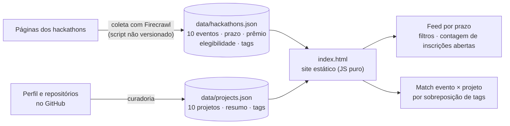

# hacka-crawl

Radar de hackathons abertos no Brasil: um site que lista os prazos de inscrição e cruza cada evento com os meus projetos do GitHub, para eu saber em quais vale a pena competir.

<!-- DEMO -->

**Site:** https://jp-mainieri.github.io/hacka-crawl/

## O problema

Hackathons são divulgados em dezenas de páginas diferentes, com prazos curtos e critérios próprios. Acompanhar isso à mão faz perder inscrições, e é difícil lembrar quais dos meus projetos já se encaixam no tema de cada evento.

## Como funciona



- **Feed:** eventos ordenados por prazo de inscrição, com filtro, e a lista se reordena sozinha quando um prazo expira com a página aberta.
- **Vitrine de projetos:** cada projeto mostra com quais eventos mais combina.
- **Match:** é uma heurística simples de sobreposição de tags: `40 + 60 × (tags em comum ÷ tags do projeto)`, limitada a 98%. Não é um modelo de IA.
- **Fontes:** cada evento guarda a URL de origem (`source_url`), e o `notes` do JSON registra o que foi descartado e por quê.

## O que é protótipo

- **Os dados são estáticos.** Foram coletados em 07/11/2026 e **não se atualizam sozinhos**: os prazos vão ficando velhos até uma nova coleta. O site só recalcula, no navegador, quem já expirou.
- **O script de coleta não está no repositório**, apenas o resultado (`data/*.json`). A coleta foi feita com o Firecrawl.
- As tags de eventos e projetos são atribuídas na própria curadoria e definem o match.
- O repositório não contém código de IA, LLM, tool calling, voz nem MCP.

## Stack

- HTML, CSS e JavaScript puros (um único `index.html`), sem build
- Dados em JSON, coletados com Firecrawl
- Publicável como site estático (GitHub Pages)

## Meu papel

Projeto pessoal, feito por mim com apoio de agentes de IA de código (há um PR aberto pelo Devin no histórico).

## Como rodar localmente

O site carrega os JSON por `fetch`, então abrir o arquivo direto no navegador não funciona. Sirva a pasta com qualquer servidor estático:

```bash
git clone https://github.com/Jp-mainieri/hacka-crawl.git
cd hacka-crawl
python3 -m http.server 8000     # http://localhost:8000
```

Para atualizar a lista, substitua `data/hackathons.json` e `data/projects.json` mantendo o mesmo formato (campos `id`, `name`, `registration_deadline`, `url`, `source_url`, `tags`, entre outros).
